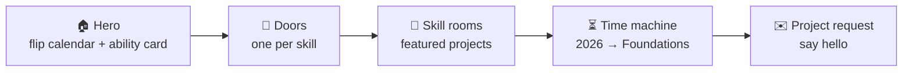

<div align="center">


<a href="https://github.com/tahseencode/Portfolio">
  
</a>

<br />

[](https://github.com/tahseencode)
[](https://www.linkedin.com/in/tahseen-raza-ansari/)
[](mailto:tahseencode@gmail.com)


<br />

**[🌐 Live Demo](#)** &nbsp;·&nbsp; **[✨ Features](#-features)** &nbsp;·&nbsp; **[🛠 Projects](#-featured-projects)** &nbsp;·&nbsp; **[🚀 Run Locally](#-run-locally)**

<!-- Add a screenshot or GIF here, e.g.  -->

</div>

<br />

---

## 📖 Table of Contents

| | | |
|---|---|---|
| [👋 About](#-about) | [🌟 Features](#-features) | [🛠 Featured Projects](#-featured-projects) |
| [⚙️ Tech Highlights](#️-tech-highlights) | [🚀 Run Locally](#-run-locally) | [☁️ Deployment](#️-deployment) |
| [🎨 Customization](#-customization) | [📬 Contact](#-contact) | [🙌 Credits](#-credits) |

---

## 👋 About

Hey, I'm **Tahseen Raza Ansari**, a B.Tech IT student who builds across full-stack web, computer vision, and machine learning.

Most portfolios are a flat list of projects. I wanted mine to feel more like a small world you can poke around in. So you can **pull a cord** to change the theme, **flip through** the hero calendar, **open a door** to step into a skill's room, and **ride a time machine** back through the timeline.

The design takes inspiration from [therishithakor.com](https://therishithakor.com/), rebuilt from scratch with its own interactions, content, and visual language.

> 💡 **The idea in one line:** every skill gets its own door, and every door leads to real work.

### 🗺️ How the tour flows



---

## 🌟 Features

<table>
<tr>
<td width="50%" valign="top">

### 🪢 Physical Pull-Cord Theme Switcher
- Verlet-integration rope hanging from the top-right corner, with gravity, spring tension, and drag
- Mechanical click sound synthesized live with the **Web Audio API** (no audio files)
- Smooth crossfade between **Warm Bone** (light) and **Charcoal** (dark) using the **View Transitions API**
- Your theme choice sticks around via `localStorage`

</td>
<td width="50%" valign="top">

### 📅 3D Mechanical Flip Calendar
- Periodic 3D page flip with binder rings and realistic lighting
- Cycles through the core disciplines:
  - *AI & ML Engineer*
  - *Full-Stack Developer*
  - *Computer Vision Dev*
  - *Systems Programmer*
  - *Creative Problem Solver*

</td>
</tr>
<tr>
<td width="50%" valign="top">

### 🃏 Holographic Ability Card
- 3D perspective tilt that follows your cursor or touch
- Prismatic foil sheen and specular glare
- Tap or click to flip between **proficiency radar metrics** and **career achievements**

</td>
<td width="50%" valign="top">

### 🚪 My Work, One Door Per Skill
- Four architectural doors with brass handles, fluted wood panels, and engraved plates
- **Hover:** the door cracks open, a golden light pool spills onto the floor, and a live skill card appears
- **Click:** the door opens and you walk into that discipline's full project showcase

</td>
</tr>
<tr>
<td width="50%" valign="top">

### ⏳ Let's Go Back In Time
- 3D rotating starfield tunnel rendered on canvas
- A rolling 4-digit mechanical odometer that runs backward through the timeline:

  `2026` → `2025` → `2024` → `Foundations`

</td>
<td width="50%" valign="top">

### ✉️ Project Request Drawer
- Service category pills
- Validated inputs
- Direct mail dispatch to `tahseencode@gmail.com`

</td>
</tr>
</table>

---

## 🛠 Featured Projects

Each discipline has its own door, and each door opens onto a room of projects.

| 🚪 Door | 📦 Projects |
|:---|:---|
| 🌐 **Web & Full-Stack** | Zero-Token Sentinel (Cost Collapser) · MediKiosk / AyurKiosk (SIH26047) · PlanMyPaisa · Netflix Clone |
| 👁️ **AI & Computer Vision** | AI Manga Translator (OCR + Inpainting) · Driver Drowsiness & Emotion Detector with Hardware Buzzer · AI Criminal Network Analysis System (SIH26189) |
| ⚡ **Systems & C++** | HybridCalculator AST Engine · Competitive Programming & Low-Level Bug Triage |
| ☁️ **Cloud & DevOps** | Multi-Cloud CI/CD & Docker · Dual SQL/NoSQL Persistence (MySQL + MongoDB) |

---

## ⚙️ Tech Highlights

| Area | What's under the hood |
|:---|:---|
| 🎨 **Theming** | CSS custom properties, View Transitions API, `localStorage` |
| 🧲 **Physics** | Verlet integration for the pull-cord rope |
| 🔊 **Audio** | Web Audio API, a synthesized click with zero assets |
| 🧊 **3D & motion** | CSS 3D transforms, perspective tilt, canvas starfield |
| 📦 **Rendering** | Static site, no build step required |

---

## 🚀 Run Locally

No build step, no dependencies. You can open `index.html` straight in a browser, or serve it locally:

```bash
# 1. Clone the repository
git clone https://github.com/tahseencode/<your-repo-name>.git
cd <your-repo-name>

# 2a. Python
python -m http.server 3000

# 2b. or Node.js
npx serve .
```

Then head to **http://localhost:3000** 🎉

> [!TIP]
> Serving over `http://localhost` is better than opening the file directly, since some browser features behave nicely only on a local server.

---

## ☁️ Deployment

It's fully static, so it deploys pretty much anywhere in seconds.

<details>
<summary><b>▲ Vercel</b></summary>

<br />

Import the repo, set the framework preset to `Other`, and leave the build command empty.

</details>

<details>
<summary><b>🐙 GitHub Pages</b></summary>

<br />

Go to **Settings → Pages** and deploy from the `main` branch root.

</details>

<details>
<summary><b>🟢 Netlify</b></summary>

<br />

Drag and drop the folder, or connect the repo.

</details>

---

## 🎨 Customization

Want to make it yours? Here's where to look:

| 🎯 What | 📍 Where |
|:---|:---|
| **Content** | Hero titles, project cards, and timeline milestones, all in `index.html` |
| **Colors** | Light and dark palette values in the CSS custom properties near the top of the stylesheet |
| **Contact address** | The email in the contact modal's mail dispatch logic |

---

## 📬 Contact

Got a project or an idea? Use the **Project Request** drawer on the site, or reach out directly:

<div align="center">

[](mailto:tahseencode@gmail.com)
[](https://www.linkedin.com/in/tahseen-raza-ansari/)
[](https://github.com/tahseencode)

</div>

---

## 🙌 Credits

Design inspiration: [therishithakor.com](https://therishithakor.com/). All code, content, and project work are by **Tahseen Raza Ansari**.

<br />

<div align="center">

⭐ **If you like this portfolio, consider starring the repo.** ⭐


</div>
